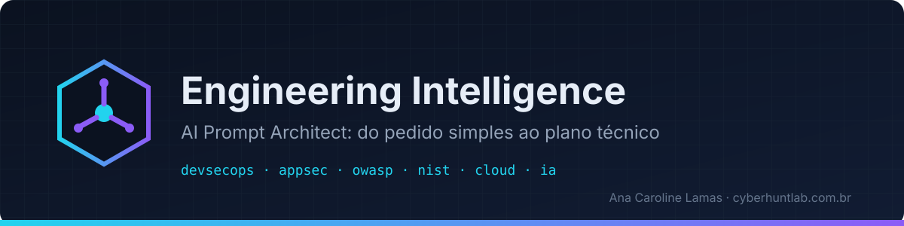

<p align="center"></p>

# Engineering Intelligence — AI Prompt Architect

Você descreve em linguagem natural (até informal ou com erros de digitação) o que quer construir, corrigir, pesquisar ou implantar. O motor **entende o problema antes de propor a solução**: classifica o projeto em vários domínios ao mesmo tempo, monta a equipe de especialistas, gera **requisitos verificáveis com ID**, escolhe só os **referenciais pertinentes** (com verificação e evidência), revisa a própria saída e dá uma **nota explicada**.

> A base de conhecimento parte das competências de engenharia de software, DevSecOps, AppSec, SecOps, Cloud, IA e pesquisa de segurança de Ana Caroline Lamas. Referenciais como SLSA, CIS e ISO entram como conhecimento do motor, não como qualificações atribuídas a ela.

## Exemplo

Entrada: *"qero cria um aplicativo andorid pra vende roupa com pix"*

- **Entendeu:** "andorid" → "android", "vende" → "vender"…
- **Domínios:** Aplicativo Android + Loja virtual.
- **Requisitos (trecho):** RF-001 Permissões mínimas em tempo de execução · RF-002 Armazenamento local seguro · RF-005 Carrinho e checkout · RF-006 Pagamento por gateway (webhook assinado, sem dados de cartão no servidor)…
- **Referenciais:** OWASP MASVS, NIST SSDF, LGPD, WCAG, OWASP ASVS, OWASP Top 10, PCI DSS.

Cada requisito traz: finalidade, comportamento esperado, entradas, saídas, restrições, critério de aceitação e teste (T-xxx).

## Interpretação semântica (v2.1)

O motor separa intenção, contexto, exemplos, restrições, hipóteses e perguntas antes de classificar o pedido. Exemplos citados ("vamos supor…") não viram requisitos. Palavras soltas não definem a categoria. Quando nenhuma categoria cadastrada serve, o motor monta uma classificação dinâmica. A **soberania tecnológica** (APIs próprias, processamento local, modelos de pesos abertos) é uma política transversal que vale para qualquer projeto. Antes da entrega, uma validação semântica remove o que não foi pedido. Detalhes em [docs/CORRECAO-INTERPRETACAO-SEMANTICA.md](docs/CORRECAO-INTERPRETACAO-SEMANTICA.md).

## Pipeline do motor

| Etapa | O que faz | Código |
|---|---|---|
| Interpretação | corrige digitação e transcrição, ignora negações ("sem backend"), detecta conflitos e repetições | `interpret()` |
| Domínios e especialistas | combina arquétipos (ex.: Android + e-commerce) e monta a equipe | `build()` + `lib/knowledge.js` |
| Requisitos | RF com 8 campos; decomposição genérica para pedidos inéditos; requisitos transversais (autenticação, LGPD) | `build()`, `genericRequirements()` |
| Arquitetura e segurança | componentes proporcionais, ameaças com controles | `composePrompt()` |
| Referenciais | motivo, requisito, controle, implementação, verificação e evidência | `STANDARDS` |
| Antirrepetição | remove frases genéricas, eco do pedido e linhas quase idênticas | `antiRepetition()` |
| Revisão crítica | 9 checagens com laço de correção limitado (`maxRevisions`) | `reviewChecks()` |
| Qualidade | rubrica de 100 pontos com deficiências explicadas | `scoreQuality()` |
| Aprendizagem | glossário, fluxo, diagrama Mermaid, decisões, comandos, erros comuns, exercícios | `learning()` |

**Níveis:** Essencial, Profissional, Avançado e Enterprise. O motor recomenda um nível e você pode trocar. Mais profundidade significa mais cobertura (matriz de rastreabilidade, ameaças, governança), não mais palavras repetidas.

**Domínios cadastrados:** pesquisa de segurança, e-commerce, Android, automação ZIP → GitHub, deploy em VPS, API REST, aplicações com IA, correção de projeto existente, pipeline DevSecOps, site/aplicação web e processamento de dados. Fora deles, o motor decompõe o pedido em entidades (ex.: *"sistema de agendamento para clínica"* → agenda, disponibilidade, papéis, lembretes) e avisa que a decomposição é genérica.

## Dois motores, sem caixa-preta

1. **Motor local** (`lib/engine.js` + `lib/knowledge.js`): regras determinísticas, roda no navegador, sem custo e sem enviar dados.
2. **Refinamento por IA** (opcional, `api/generate.js`): o modelo recebe o [prompt mestre](lib/master-prompt.js) e a análise local (requisitos, conflitos, perguntas) e deve manter os IDs. Tem limite por visitante e diário, tempo máximo e volta ao motor local se falhar. A tela sempre mostra qual motor gerou o resultado.

## Estrutura

```
index.html  styles.css  app.js        interface (HTML/CSS/JS puro, sem dependências)
lib/engine.js                         motor de raciocínio (ESM)
lib/knowledge.js                      base de conhecimento modular
lib/master-prompt.js                  prompt mestre do refinamento por IA
api/generate.js  api/health.js        funções serverless (Vercel)
tests/                                28 testes com node:test (inclui os 15 cenários de aceitação)
tools/compare.mjs                     comparação v1 × v2 (motor antigo em tools/legacy)
RELATORIO-COMPARATIVO.md              resultado medido da comparação
```

## Rodar e testar

```bash
npm test                 # Node 18+, sem instalar nada
node tools/compare.mjs   # tabela v1 × v2 nos 15 cenários
npx vercel dev           # servidor local com as funções
```

## Deploy na Vercel

1. Importe o repositório. Não há build: o site é estático e as funções ficam em `api/`.
2. (Opcional) Para a IA, cadastre as variáveis de [`.env.example`](.env.example): `AI_PROVIDER` (`openai` ou `gemini`), `AI_API_KEY`, `AI_MODEL` e os limites.

## Segurança

- Chave de IA só no servidor; `/api/health` informa apenas se a IA está ativa.
- Entrada limitada a 2.000 caracteres e corpo JSON a 16 KB.
- Limite por IP e diário (em memória por instância; para limite global use Vercel Firewall ou KV).
- CSP restrita (`script-src 'self'`), HSTS e `frame-ancestors 'none'`, sem scripts de terceiros.

## Limitações

- Interpretação por regras e conhecimento cadastrado, não por modelo de linguagem; domínios novos recebem decomposição genérica sinalizada.
- Referenciais sem números de controle: o motor não consulta fontes oficiais e não inventa identificadores.
- A nota mede o atendimento à rubrica; não garante a qualidade do software que será construído.

## Licença

MIT · Ana Caroline Lamas · [cyberhuntlab.com.br](https://cyberhuntlab.com.br)
